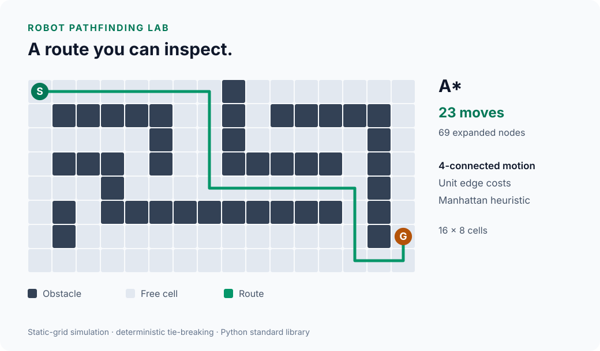

# Robot Pathfinding Lab

[](https://github.com/arslan1t/robot-pathfinding-lab/actions/workflows/ci.yml)


[](LICENSE)

A reproducible lab for comparing **A\*** and **Dijkstra** on occupancy grids:
working search code, an independent BFS oracle, seeded benchmarks, and inspectable
route visualizations. Python 3.10+, standard library only.



## Run it

```sh
python3 planner.py demo.map
python3 planner.py demo.map --algorithm dijkstra
python3 -m unittest -v
python3 benchmark.py
python3 visualize.py demo.map
```

`S` is the start, `G` the goal, `#` an obstacle, `.` free space. The planner
overlays `*` on the route and reports move cost and expanded nodes. Exit status
`0` means a route exists; `2` means the goal is unreachable.

The benchmark writes [benchmarks.csv](benchmarks.csv) and an accompanying
[environment report](benchmarks.meta.json). The visualizer writes
[demo-route.svg](demo-route.svg), a self-contained vector graphic with an
accessible description. No account, API key, or package installation is required.

## What the benchmark checks

The default corpus contains **14 distinct 80 × 50 maps**. Every map is evaluated
by both algorithms, with one warm-up and nine measured runs per algorithm.
All **28 algorithm/map pairs** must match an independent breadth-first search
oracle. Every returned route is also checked for correct endpoints, traversable
cells, adjacent steps, and deterministic output across repetitions.

| Scenario | Cases | Construction |
| --- | ---: | --- |
| Open room | 1 | Bounded free space; off-corner goal |
| Sparse random occupancy | 4 | 18% obstacle probability before endpoint clearance |
| Dense random occupancy | 4 | 32% obstacle probability before endpoint clearance |
| Warehouse | 4 | Three-cell racks, variable rack lengths, vertical and cross aisles |
| Unreachable | 1 | A solid partition separates start and goal |

The four generated layouts use seeds **0, 7, 42, 2026** in each seeded scenario.
Random maps clear a radius-three square around each endpoint, clipped to the
interior, to model access areas. No connecting route is carved; disconnected
samples are retained. Exterior walls and cleared access areas mean the final
obstacle ratio differs from the sampling probability. Each map's SHA-256 is
recorded so runs can be matched by workload, not just by seed.

### Committed sample results

These are deterministic search counts from the committed corpus. Cost is the
optimal number of moves, independently checked by BFS. Expanded nodes include
the goal when it is reached.

| Map | Cost | A* expanded | Dijkstra expanded |
| --- | ---: | ---: | ---: |
| Open room | 101 | 1,950 | 3,445 |
| Sparse random, seed 7 | 103 | 820 | 2,839 |
| Dense random, seed 42 | 119 | 1,160 | 2,285 |
| Warehouse, seed 42 | 101 | 1,542 | 2,707 |
| Partitioned room | No route | 1,872 | 1,872 |

All 12 reachable maps produced the same optimal cost under both algorithms;
A* expanded fewer nodes on each of those maps. Both algorithms exhaust the
start's connected component on the two unreachable maps. See the CSV for all
cases, including the disconnected dense-random sample.

Timing columns contain the median, minimum, and maximum of nine runs measured
with `perf_counter_ns`. The committed sample ran on **CPython 3.12.14, Darwin
25.5.0, arm64**. Only the search call is timed; generation, BFS, validation and
file I/O are excluded. Algorithms run in a fixed order without process isolation.
These small, single-machine measurements are not a general speedup claim.

To change the workload or repeat the measurements without overwriting the sample:

```sh
python3 benchmark.py --width 96 --height 64 --seeds 0 7 42 2026 \
  --repeats 15 --output local-results.csv
python3 visualize.py demo.map --algorithm dijkstra --output dijkstra-route.svg
```

## Search design

- Four-connected motion with unit edge costs; no diagonal corner cutting.
- Manhattan distance is admissible and consistent for this movement model.
- Dijkstra uses the same search engine with a zero heuristic, isolating the
  effect of the heuristic rather than comparing different queue implementations.
- The priority queue breaks equal-priority ties by insertion order. Ties can
  still make A* explore many equal-cost candidates.
- Stale queue entries are skipped. Parents reconstruct the route without copying
  the whole path into every queue entry.

Distances and parents require O(V) storage; heap operations give
O((V + E) log V) time on this bounded-degree grid. Results concern point-robot
planning on a known static map, not physical robot navigation.

## Validation and CI

The **14 unit tests** include 150 additional seeded random maps checked against
an independent test oracle, blocked endpoints, invalid maps, unreachable goals,
known-cost fixtures, deliberately corrupted routes, corpus reproducibility,
warehouse connectivity, CSV/environment export, and SVG route integrity.

The [CI workflow](.github/workflows/ci.yml) runs the tests and the complete
benchmark corpus on Python **3.10, 3.12, and 3.13**. It also regenerates the
illustration and checks that it exactly matches the committed SVG.

## Scope and next steps

This is a simulation with static maps, a point robot, and no localization error
or dynamics. A physical robot would also need footprint inflation, sensor
uncertainty handling, and local collision avoidance. Next useful experiments:
weighted terrain, alternative tie-breaking rules, and replanning after an
obstacle changes. MIT licensed.
